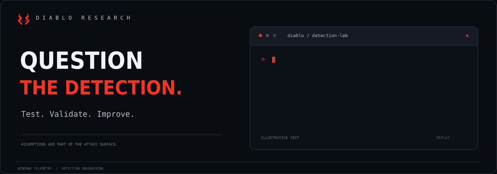

  

## Detection engineering, backed by evidence.

Investigating detection gaps, validating telemetry, and contributing improvements to open-source security tools.

  

## Research focus

| Area | Focus |
| --- | --- |
| Windows telemetry | Sysmon filtering and visibility |
| Detection resilience | Renamed executable detection |
| Validation | Reproducible tests and documented evidence |
<!--
## Open-source contributions

- [SigmaHQ / sigma](https://github.com/SigmaHQ/sigma/pulls?q=is%3Apr+author%3ADiablo-research) — Rule development and improvements for detection content.
- [Splunk / security_content](https://github.com/splunk/security_content/pulls?q=is%3Apr+author%3ADiablo-research) — Detection validation and content enhancements.
-->
